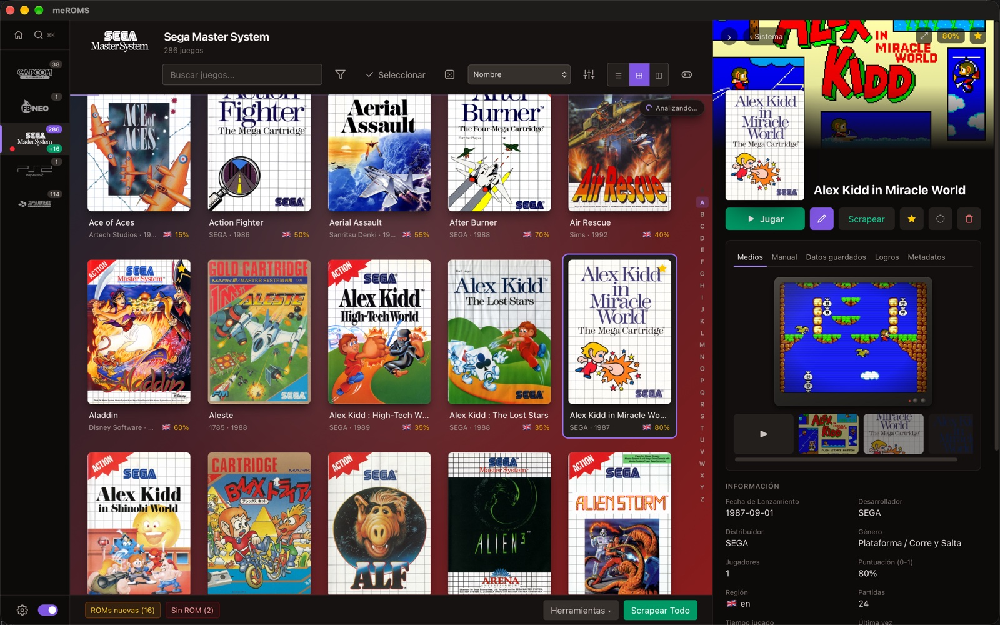
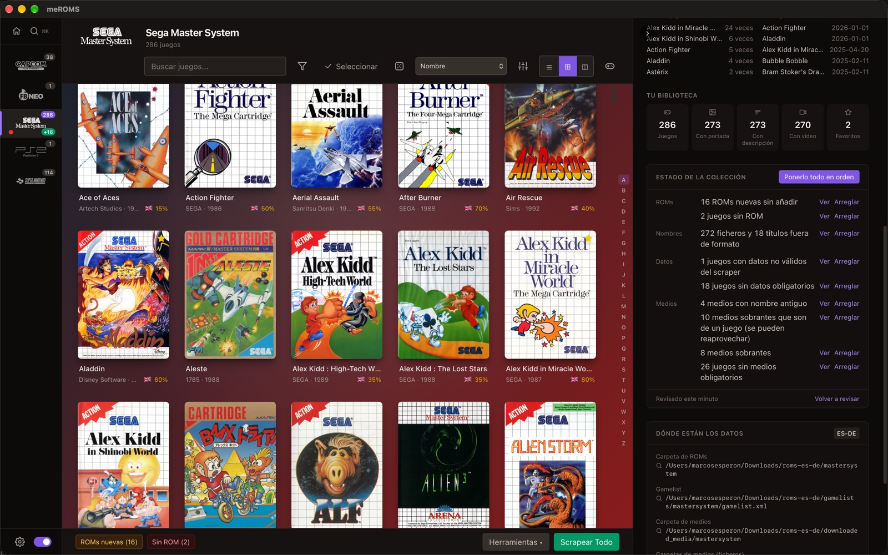
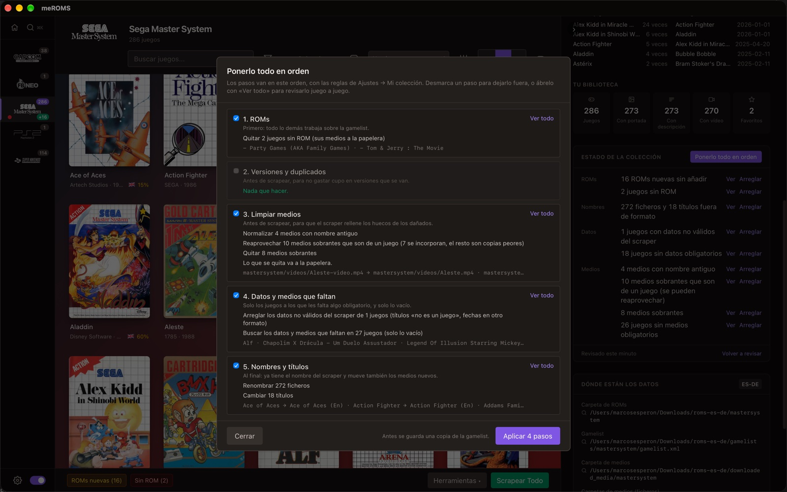
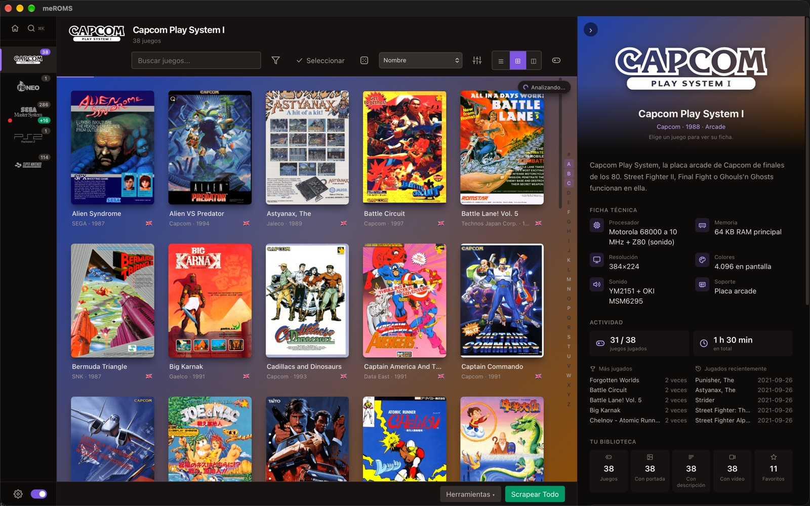
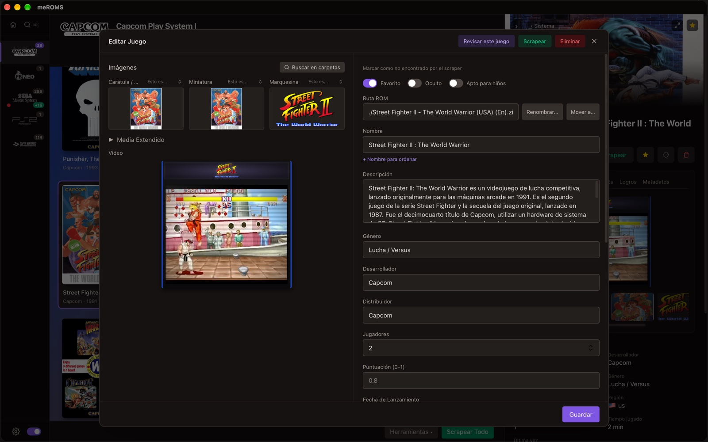

# meROMS

[](https://github.com/marcosesperon/meROMS/releases/latest)
[](https://buymeacoffee.com/marcosesperon)

**A desktop app to tidy up your EmulationStation and ES-DE game library.**
Browse your systems, fix game names and descriptions, add the missing box art and videos, keep
every system in order and play - without editing a single `gamelist.xml` by hand.

**Website:** <https://marcosesperon.github.io/meROMS/> (English and Spanish)



## Who is it for?

If you have a retro collection for **EmulationStation** (RetroPie, Batocera, Recalbox...) or
**ES-DE** (EmulationStation Desktop Edition, RetroBat...), every system keeps a `gamelist.xml`
with the names, descriptions, ratings and media of its games. meROMS lets you see and edit all of
that from your computer, comfortably and in bulk, and keep the whole collection in order.

It manages your library and can also **launch your games** with ES-DE's emulator setup; your
frontend stays the same.

Free and open source, for macOS, Windows and Linux, in English, Spanish, French, Portuguese,
Italian and German.

## What it does

**Your collection in order**
- **My collection** (Settings): say once what your collection must meet - which data and media
  every game needs, what to do with extra versions (set aside, hide or trash), never touch
  favourites or played games, what to do with leftover media.
- **System status**: the system summary lists what isn't met, with a number for each line (new
  ROMs, games without ROM, games with several versions, names out of format, games missing data
  or media, damaged or leftover media, swapped covers...). The number filters the list, **View**
  opens the tool and **Fix** does it. A green check when everything is fine.
- **Put it all in order**: one window runs the steps (ROMs, versions, media, scrape what's
  missing, names) with a preview of each, for the whole system, the games shown or the marked
  ones. A backup first and a single **Undo** for all of it.
- **Versions and duplicates**: the games that are the same (same ScreenScraper ID, same file,
  same DAT game or the same name without tags), which one stays and why (your region and
  language, complete discs, more media, more data), and the rest set aside, hidden, sent to the
  trash or deleted permanently.
- **Media**: damaged files and placeholders, leftovers (and the ones that can be **reused** for
  the game they belong to), covers and screenshots saved the wrong way round, old-named files.
- **Rename**: file name from a chain of sources (DAT, ScreenScraper, GoodTools > No-Intro, the
  gamelist's title and region), cleanup rules, which tags stay; the title follows. Media,
  gamelist, collections and `.m3u` playlists follow along, and it can be undone.
- **Clear fields**: empty a data field, a flag, the play stats or a media type in the whole
  system, the games shown or the marked ones.
- Repeated gamelist entries (the same ROM twice) are found and merged.

**Browse and edit**
- Cover grid (flat or **3D boxes**), table (choose and reorder the columns) or carousel; search,
  filters, jump to a letter, keyboard and gamepad.
- A side panel with the game's artwork, video (in a TV or arcade-cabinet frame) and details; a
  full-screen game page with the media, the **PDF manual**, the saved games and the file's own
  data (hashes, DAT check, raw gamelist fields); a full editor for every field and media type.
- Resting on a game opens its box and plays the video (also in the flat grid).
- **Right-click** a game for everything you can do with it; **multi-select** (Cmd/Ctrl+click,
  Shift+click) to scrape, rename, put in order, move or remove many at once, or to edit common
  fields, find & replace and translate descriptions with DeepL.
- Game statuses (playing, finished, completed, abandoned...), favourites, hidden.
- Global search in every system (Cmd/Ctrl+K).

**Get what's missing**
- Scrape names, descriptions, dates, ratings and media from **ScreenScraper**, with
  **LaunchBox** (a free database you download once: no account, no daily limit),
  **ArcadeItalia** (arcade, no account) and **TheGamesDB** as fallbacks, for one game, the
  marked ones or a whole system.
- **Scrape** on one game searches every source and lets you pick the right result (the one that
  matches your ROM file comes first). Games the scraper didn't find are marked and skipped next
  time unless you ask to retry them.
- You decide what may be overwritten (per field and media type) and your preferred regions and
  languages.
- **New ROMs**: the ROM files the gamelist doesn't know yet, added with clean names and, if you
  want, scraped and renamed at once. The ROM folders are watched: new and missing ROMs show in
  the sidebar by themselves.
- **Import ROMs** from another folder (Classic, ES-DE or loose files): a preview says which games
  are new, another version or already yours. Games you already have are completed (missing data
  and media) instead of duplicated; files that aren't of that system wait behind a checkbox.

**Play**
- Launch games with ES-DE's emulator setup (or your own command per system); play time and
  count are saved.
- **Couch mode**: full screen, for a gamepad.
- **Which game?**: a roulette picks one for you. **Continue playing** on the start screen.
- **RetroAchievements**: which games are compatible and your progress.
- Library statistics on the start screen.

**Organise and move**
- Several **profiles** (libraries), also on an SD card or USB disk that isn't always plugged in.
- **DAT files** (MAME, Logiqx, No-Intro): missing games, unknown files, clones and BIOS; ROMs
  recognised by their content (CRC32, also inside zip/7z).
- Multi-disc `.m3u` playlists, custom collections, **BIOS check**, discs to **CHD**.
- **Move** games to another system or subfolder, take a whole system to another profile,
  **import** ROMs, **delete** a system, compare with another folder, **export to a device**
  (SD card, USB) and bring the play stats back.
- **Migrate** a library, or some systems, from classic EmulationStation to ES-DE or back.
- Automatic **backup** of every gamelist before saving, and **Undo** for renames, moves, media
  changes and set-aside games. Removed files go to the **trash** unless you choose otherwise.
- Long tasks show their progress, can be stopped, and their window stays open until they finish.

## Classic EmulationStation or ES-DE

meROMS works with both folder structures. You save each library as a **profile** and switch
between them:

| | Classic | ES-DE |
|---|---|---|
| Gamelist | `ROMs/snes/gamelist.xml` | `ES-DE/gamelists/snes/gamelist.xml` |
| Media | `ROMs/snes/covers/Aladdin.png` | `ES-DE/downloaded_media/snes/covers/Aladdin.png` |
| ROMs | `ROMs/snes/Aladdin.zip` | `ROMs/snes/Aladdin.zip` |

For ES-DE, meROMS reads ES-DE's own settings (custom ROM and media folders, portable installs).

## Download and install

Get the latest version from the
[Releases page](https://github.com/marcosesperon/meROMS/releases/latest):

| System | File |
|---|---|
| macOS (Intel and Apple Silicon) | `meROMS_<version>_universal.dmg` |
| Windows 10 / 11 | `meROMS_<version>_x64-setup.exe` (or the `.msi`) |
| Linux | `.AppImage` (any distro), `.deb` (Debian / Ubuntu) or `.rpm` (Fedora / openSUSE) |

The installers are **not signed** yet, so the system warns the first time:

- **macOS**: open the `.dmg`, drag meROMS to Applications, then right-click the app > **Open** >
  **Open**. (Or run `xattr -dr com.apple.quarantine /Applications/meROMS.app`.)
- **Windows**: if SmartScreen appears, click **More info** > **Run anyway**.
- **Linux**: for the AppImage, `chmod +x meROMS_*.AppImage` and run it; for the packages,
  `sudo apt install ./meROMS_*.deb` or `sudo dnf install ./meROMS-*.rpm`.

## Getting started

1. **Create a profile.** On first launch meROMS opens Settings > Profiles: pick your ROM folder
   and its structure (Classic or ES-DE). For ES-DE, choosing the ES-DE folder fills in the rest.
2. **Say what your collection must meet** in Settings > My collection (the defaults are a good
   start).
3. **Pick a system** in the left bar. Click a game to see its details; double-click (or **Edit**)
   to change it. With no game selected, the right panel shows the system's status.
4. **Scrape.** Enter your ScreenScraper account in Settings > Scraper (free at
   [screenscraper.fr](https://www.screenscraper.fr/)), or download the LaunchBox database, and
   use **Scrape All**. Check "What the scraper updates" first if you don't want existing data
   overwritten.
5. **Put it all in order** from the system status, or use the **Tools** menu at the bottom for
   each tool on its own.

Every save makes a backup of the gamelist first (Tools > Backups to restore one).

| System status | Put it all in order |
|---|---|
|  |  |

## Updates

meROMS checks for a new version when it starts (and once a day while open). When there is one, a
bar appears at the top: **View and update** shows what's new and installs it, then restarts the
app. You can turn the check off, or check by hand, in Settings > About.

## FAQ

**Does it change my ROM files?**
Only if you ask it to: renaming, moving, importing, converting to CHD, or removing versions and
unwanted files. Editing, scraping and migrating never touch the ROMs themselves.

**Can I undo a change?**
Every gamelist is backed up before each save (the last 20 are kept, next to the gamelist in
`.backups/`). Renames, moves, media changes, set-aside games and Put it all in order can be
undone from Tools. Removed files go to the system trash, unless you tick "Delete permanently".

**Do I need an account to scrape?**
No: download the LaunchBox database in Settings > Scraper, and arcade systems also use
ArcadeItalia. A free ScreenScraper account is still recommended (the most complete source, with
videos). TheGamesDB can be used with its own API key.

**What if Scrape All is cut halfway?**
Nothing done is lost: the gamelist is saved every 10 games, and **Stop** saves at once. The next
**Scrape All** on that system offers to **Continue** with the games left (and the same rules) or
to start over.

**Does it work with RetroPie / Batocera / RetroBat...?**
Yes, as long as they use EmulationStation (classic) or ES-DE gamelists. Point the profile at the
ROM folder, local, on a network drive or on an SD card.

**Can it run my games?**
Yes, with ES-DE's emulator setup (the one ES-DE would use on your computer, plus your
`custom_systems`), or a command you set per system.

| System details | Game editor |
|---|---|
|  |  |

## Support

meROMS is free. If it saves you time, you can
[buy me a coffee](https://buymeacoffee.com/marcosesperon). Bugs and ideas are welcome in
[Issues](https://github.com/marcosesperon/meROMS/issues).

## License

meROMS is open source under the [MIT License](LICENSE). The built-in rename rules come from
[ES-DE-Roms-Renamer](https://github.com/mirai-toto/ES-DE-Roms-Renamer) (also MIT). The manual
viewer uses [PDF.js](https://mozilla.github.io/pdf.js/) by Mozilla (Apache License 2.0).

The system logos (`src/assets/logos/`) are not MIT: they are trademarks of their owners, taken
from EmulationStation themes under CC BY-NC-SA
([Carbon](https://github.com/fabricecaruso/es-theme-carbon),
[Slate](https://gitlab.com/es-de/themes/slate-es-de) and most likely es-theme-simple), many of
them recoloured to white. See `LICENSE`.

Scraped data and media belong to their sources: [ScreenScraper](https://www.screenscraper.fr/),
[LaunchBox Games Database](https://gamesdb.launchbox-app.com/),
[ArcadeItalia](https://adb.arcadeitalia.net/) (game histories from
[arcade-history.com](https://www.arcade-history.com/)) and [TheGamesDB](https://thegamesdb.net/).
The BIOS list is libretro's [System.dat](https://github.com/libretro/libretro-database) (CC BY-SA
4.0): it is downloaded from Settings, not included in meROMS.

---

## For developers

Built with [Tauri v2](https://tauri.app/) (Rust) + React 19 + TypeScript + Tailwind CSS.
Architecture notes for contributors are in `CLAUDE.md`. The website source is in `site/`,
published by `.github/workflows/pages.yml`.

### Building the app from source

The app has to be built **on the same operating system it is for**: build the Windows installer
on Windows, the macOS app on macOS and the Linux packages on Linux. Cross-compiling is not
supported by this guide.

#### 1. Install the prerequisites

Every platform needs:

| Tool | Version | Why |
|---|---|---|
| [Git](https://git-scm.com/downloads) | any recent | to download the project |
| [Node.js](https://nodejs.org/) | **22 LTS** (20.19+ also works) | builds the user interface (Vite 7) |
| [pnpm](https://pnpm.io/) | 10 or newer | installs the JavaScript dependencies |
| [Rust](https://www.rust-lang.org/tools/install) (via `rustup`) | latest stable | builds the native app |

Recommended way to get pnpm: it ships with Node.js through Corepack, so after installing Node.js
just run:

```bash
corepack enable
corepack prepare pnpm@latest --activate
pnpm --version
```

Then the platform-specific system libraries:

##### macOS

1. Install the Xcode Command Line Tools (compiler and SDK):

   ```bash
   xcode-select --install
   ```

2. Install Rust:

   ```bash
   curl --proto '=https' --tlsv1.2 -sSf https://sh.rustup.rs | sh
   source "$HOME/.cargo/env"
   ```

3. Install Node.js 22 LTS from [nodejs.org](https://nodejs.org/) or with Homebrew
   (`brew install node@22`), then run the Corepack commands above.

##### Windows (10 / 11)

1. Install the **Microsoft C++ Build Tools**: download
   [Visual Studio Build Tools](https://visualstudio.microsoft.com/visual-cpp-build-tools/) and,
   in the installer, tick the **"Desktop development with C++"** workload.
2. **WebView2**: already included in Windows 10 (version 1803 or later) and Windows 11. If it is
   missing, install the "Evergreen Bootstrapper" from
   [Microsoft](https://developer.microsoft.com/microsoft-edge/webview2/).
3. Install Rust with [rustup-init.exe](https://www.rust-lang.org/tools/install) and keep the
   default **MSVC** toolchain (`stable-x86_64-pc-windows-msvc`).
4. Install Node.js 22 LTS from [nodejs.org](https://nodejs.org/) (or
   `winget install OpenJS.NodeJS.LTS`), then run the Corepack commands above in a new terminal.
5. Install Git from [git-scm.com](https://git-scm.com/download/win) (or `winget install Git.Git`).

Close and reopen the terminal (PowerShell) after installing everything so the new `PATH` is
picked up. The installer tools (NSIS and WiX) are downloaded automatically by Tauri the first
time you build.

##### Linux

Install the WebKitGTK libraries and build tools for your distribution:

**Debian / Ubuntu / Linux Mint** (Ubuntu 22.04 or newer):

```bash
sudo apt update
sudo apt install -y git curl wget file build-essential pkg-config \
  libwebkit2gtk-4.1-dev libxdo-dev libssl-dev \
  libayatana-appindicator3-dev librsvg2-dev
```

**Fedora**:

```bash
sudo dnf check-update
sudo dnf install -y git curl wget file openssl-devel \
  webkit2gtk4.1-devel libappindicator-gtk3-devel librsvg2-devel libxdo-devel
sudo dnf group install -y "c-development"
```

**Arch Linux / Manjaro**:

```bash
sudo pacman -Syu --needed git curl wget file base-devel openssl \
  webkit2gtk-4.1 appmenu-gtk-module libappindicator-gtk3 librsvg xdotool
```

Then install Rust and Node.js:

```bash
curl --proto '=https' --tlsv1.2 -sSf https://sh.rustup.rs | sh
source "$HOME/.cargo/env"
# Node.js 22 LTS: use your distro's package, nvm or https://nodejs.org/
```

and run the Corepack commands above.

##### Check that everything is in place

```bash
git --version
node --version     # v22.x (or v20.19+)
pnpm --version     # 10.x or newer
rustc --version    # rustc 1.8x or newer
cargo --version
```

#### 2. Download the project

```bash
git clone https://github.com/marcosesperon/meROMS.git
cd meROMS
```

To update an existing copy later: `git pull`.

#### 3. Install the dependencies

```bash
pnpm install
```

This installs the JavaScript packages (including the Tauri CLI). The Rust crates are downloaded
automatically during the first build.

#### 3b. (Optional) ScreenScraper developer credentials

meROMS can carry its own ScreenScraper developer credentials, so users only need their
ScreenScraper username and password. They are never stored in the repository. To build them in:

```bash
cp src-tauri/screenscraper.env.example src-tauri/screenscraper.env
# edit src-tauri/screenscraper.env and fill in MEROMS_SS_DEVID and MEROMS_SS_DEVPASSWORD
```

(or set the environment variables `MEROMS_SS_DEVID` and `MEROMS_SS_DEVPASSWORD` before building).
`screenscraper.env` is ignored by git. Without it the app still builds: users then enter developer
credentials in Settings > General > ScreenScraper > Advanced.

#### 4. Build the app

```bash
pnpm tauri build
```

The first build takes several minutes (it compiles all the Rust dependencies); later builds are
much faster. When it finishes, the results are in `src-tauri/target/release/bundle/`:

| Platform | What you get | Where |
|---|---|---|
| **macOS** | App bundle | `bundle/macos/meROMS.app` |
| | Disk image (installer) | `bundle/dmg/meROMS_0.1.0_<arch>.dmg` |
| **Windows** | Setup program (recommended) | `bundle/nsis/meROMS_0.1.0_x64-setup.exe` |
| | MSI installer | `bundle/msi/meROMS_0.1.0_x64_en-US.msi` |
| **Linux** | Debian/Ubuntu package | `bundle/deb/meROMS_0.1.0_amd64.deb` |
| | Fedora/openSUSE package | `bundle/rpm/meROMS-0.1.0-1.x86_64.rpm` |
| | Portable AppImage | `bundle/appimage/meROMS_0.1.0_amd64.AppImage` |

The bare executable (without installer) is also at `src-tauri/target/release/meroms`
(`meroms.exe` on Windows).

##### Building only some formats

By default every format of the current OS is built. To build just one (faster):

```bash
pnpm tauri build --bundles dmg            # macOS: only the .dmg (app)
pnpm tauri build --bundles nsis           # Windows: only the -setup.exe
pnpm tauri build --bundles deb,appimage   # Linux: .deb and AppImage
```

##### macOS: one app for Intel and Apple Silicon

```bash
rustup target add aarch64-apple-darwin x86_64-apple-darwin
pnpm tauri build --target universal-apple-darwin
```

The universal app is left in `src-tauri/target/universal-apple-darwin/release/bundle/`.

#### 5. Install and run

- **macOS**: open the `.dmg` and drag **meROMS** to Applications. The build is not signed, so the
  first time macOS will block it: right-click the app > **Open** > **Open**, or run
  `xattr -dr com.apple.quarantine /Applications/meROMS.app`.
- **Windows**: run `meROMS_0.1.0_x64-setup.exe`. As the installer is not signed, SmartScreen may
  warn: click **More info** > **Run anyway**.
- **Linux**:
  - `.deb`: `sudo apt install ./meROMS_0.1.0_amd64.deb`
  - `.rpm`: `sudo dnf install ./meROMS-0.1.0-1.x86_64.rpm`
  - AppImage: `chmod +x meROMS_0.1.0_amd64.AppImage && ./meROMS_0.1.0_amd64.AppImage`

On first launch the app opens the Settings window so you can create a profile (your ROM folder
and its structure: Classic or ES-DE).

#### Troubleshooting

- **`pnpm: command not found`**: run `corepack enable` again, or install pnpm with
  `npm install -g pnpm`.
- **Windows: `link.exe not found` / MSVC errors**: the "Desktop development with C++" workload of
  the Build Tools is missing (step 1 of the Windows prerequisites).
- **Linux: `webkit2gtk-4.1` not found**: your distribution is too old for Tauri v2 (Ubuntu 22.04+,
  Debian 12+ or Fedora 36+ are needed), or the `-dev` packages above are not installed.
- **Strange build errors after updating**: delete the build caches and try again:
  `rm -rf node_modules src-tauri/target && pnpm install && pnpm tauri build`.

---

### Automated builds (GitHub Actions)

Instead of building on each operating system yourself, GitHub can build all the installers on
its own Windows, macOS and Linux machines. The workflow is in `.github/workflows/build.yml`.

1. (Optional) Bump the version in `src-tauri/tauri.conf.json` (`"version"`), commit and push.
   To build meROMS' ScreenScraper developer credentials into the installers, create the
   repository secrets `SS_DEVID` and `SS_DEVPASSWORD` (Settings > Secrets and variables >
   Actions). Without them the installers are built without credentials.
   The Release is named after that version, so with the same version the same Release is reused.
2. On GitHub, open the **Actions** tab > **Build installers** > **Run workflow** (branch `main`).
3. Wait for the three jobs (macOS, Windows, Linux) to finish. The first run takes about
   15-25 minutes; later runs are faster thanks to the build cache.
4. Open **Releases**: there is a **draft** called `meROMS v<version>` with every installer
   attached:
   - macOS: one universal `.dmg` (Intel and Apple Silicon)
   - Windows: `-setup.exe` and `.msi`
   - Linux: `.deb`, `.rpm` and `.AppImage`
5. Check it and press **Publish release** to make it public. Until then only you can see it.

#### Self-update

From 0.1.4 on, meROMS checks GitHub for a newer version (at start and once a day; it can be turned
off in Settings > About) and can download, install and restart by itself. For that:

- The update files are signed with meROMS' own updater key. The build workflow reads it from the
  repository secrets `TAURI_SIGNING_PRIVATE_KEY` and `TAURI_SIGNING_PRIVATE_KEY_PASSWORD`; the
  public key is in `src-tauri/tauri.conf.json` (`plugins.updater.pubkey`). **Keep the private key
  safe**: without it, installed copies will not accept new versions.
- When you **publish** a Release, `.github/workflows/updater.yml` builds its `latest.json` (what the
  app reads) from the signed files and the Release notes. Write the notes before publishing, or
  run that workflow by hand afterwards (Actions > Update manifest).
- Drafts are never offered: the app only looks at the latest published Release.

The installers are not signed, so the notes in "Install and run" above apply. Actions minutes are
free for public repositories; for private ones they count against your plan (macOS minutes x10,
Windows x2).

---

### Development

```bash
pnpm tauri dev                                  # app with hot reload (Vite + Rust + window)
pnpm dev                                        # interface only, in the browser (no Tauri APIs)
pnpm build                                      # type-check and build the interface
cargo test --manifest-path src-tauri/Cargo.toml # Rust unit tests
```

Recommended editor: [VS Code](https://code.visualstudio.com/) with the
[Tauri](https://marketplace.visualstudio.com/items?itemName=tauri-apps.tauri-vscode) and
[rust-analyzer](https://marketplace.visualstudio.com/items?itemName=rust-lang.rust-analyzer)
extensions.

Architecture notes for contributors are in `CLAUDE.md`.
