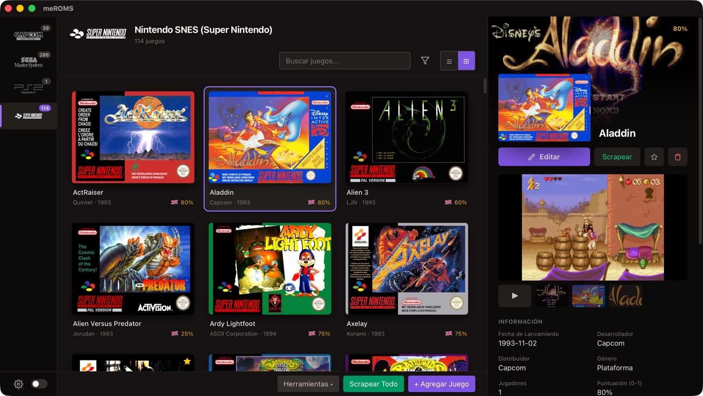
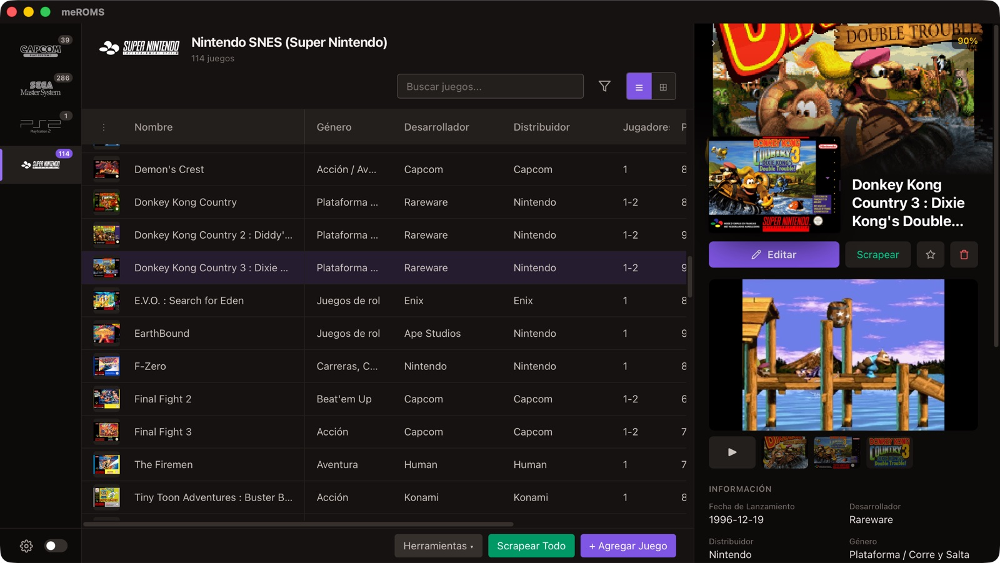
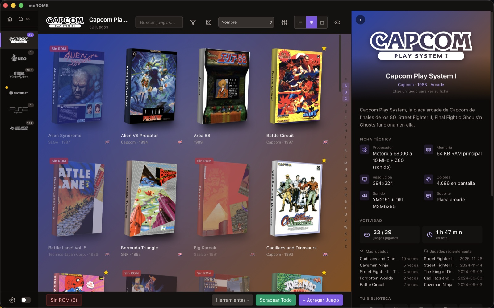
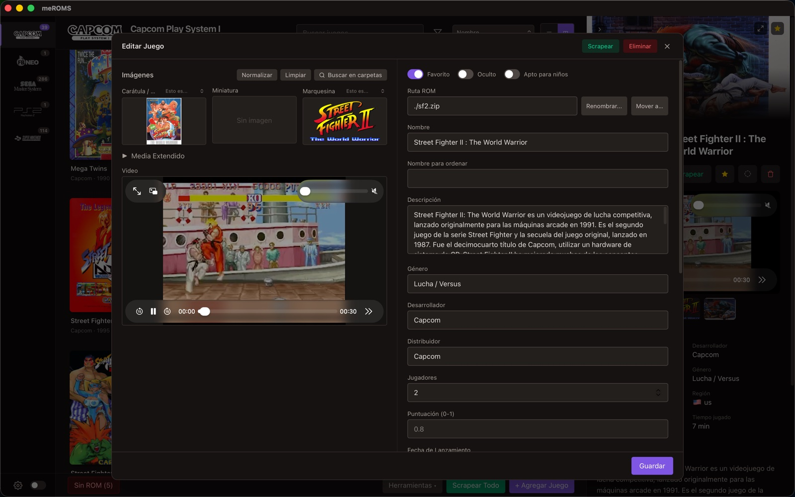

# meROMS

[](https://github.com/marcosesperon/meROMS/releases/latest)
[](https://buymeacoffee.com/marcosesperon)

**A desktop app to tidy up your EmulationStation and ES-DE game library.**
Browse your systems, fix game names and descriptions, add the missing box art and videos, and
clean up what's left over - without editing a single `gamelist.xml` by hand.

**Website:** <https://marcosesperon.github.io/meROMS/> (English and Spanish)



## Who is it for?

If you have a retro collection for **EmulationStation** (RetroPie, Batocera, Recalbox...) or
**ES-DE** (EmulationStation Desktop Edition, RetroBat...), every system keeps a `gamelist.xml`
with the names, descriptions, ratings and media of its games. meROMS lets you see and edit all of
that from your computer, comfortably and in bulk.

It **manages your library; it doesn't play games**. Your emulator frontend stays the same.

Free and open source, for macOS, Windows and Linux, in English and Spanish.

## What it does

**Browse and edit**
- Cover grid or table view (choose and reorder the columns), search and filters (genre, region,
  favourites, hidden, clones, missing media...), keyboard navigation.
- Filter the games missing a cover, a video... and **Scrape All** only those.
- A side panel with the game's artwork, screenshots, video and details; a full editor for every
  field and every media type.
- Edit many games at once: common fields, favourite/hidden flags, find & replace.

**Get what's missing**
- Scrape names, descriptions, dates, ratings and media from **ScreenScraper**, with
  **LaunchBox** (a free database you download once: no account, no daily limit),
  **ArcadeItalia** (arcade, with videos, no account) and **TheGamesDB** as fallbacks, for one game,
  some games or a whole system.
- **Scrape** on one game searches every source and lets you pick the right result (the one that
  matches your ROM file comes first); after **Scrape All**, the games it couldn't find can be
  searched the same way.
- You decide what may be overwritten (per field and media type) and your preferred regions and
  languages.
- **New ROMs**: find ROM files the gamelist doesn't know yet and add them with clean names.

**Clean up**
- Duplicate games, games whose ROM is gone, media nobody uses, the same image saved as several
  types, and broken media links in the XML.
- Placeholders: the same empty image or video a source gives for many games (like ScreenScraper's
  blank green back covers). They're learned, so the scraper skips them from then on.
- Damaged media: empty files, error pages saved as images and downloads cut halfway, with an
  offer to download them again.
- Covers and screenshots saved the wrong way round: detected by their shape and swapped.
- Files are sent to the **trash**, never deleted outright.

**Rename**
- Rename ROM files from their title or with cleanup rules (regular expressions, compatible with
  ES-DE-Roms-Renamer). Media, gamelist, collections and `.m3u` playlists follow along.

**Organise**
- **DAT files** (MAME, Logiqx, No-Intro): missing games, unknown files, clones and BIOS; ROMs
  are recognised by their content (CRC32, also inside zip/7z), and Rename can use the DAT's
  official names.
- Multi-disc games: generate their `.m3u` playlists. Custom collections.
- Automatic **backup** of every gamelist before saving, with restore.

**Move between structures**
- Migrate a whole library, or some systems, from classic EmulationStation to ES-DE or back
  (copy or move). Your ROMs are never touched.

## Classic EmulationStation or ES-DE

meROMS works with both folder structures. You save each library as a **profile** and switch
between them:

| | Classic | ES-DE |
|---|---|---|
| Gamelist | `ROMs/snes/gamelist.xml` | `ES-DE/gamelists/snes/gamelist.xml` |
| Media | `ROMs/snes/covers/Aladdin.png` | `ES-DE/downloaded_media/snes/covers/Aladdin.png` |
| ROMs | `ROMs/snes/Aladdin.zip` | `ROMs/snes/Aladdin.zip` |

For ES-DE, meROMS reads ES-DE's own settings (custom ROM and media folders, portable installs).

## Download and install

Get the latest version from the
[Releases page](https://github.com/marcosesperon/meROMS/releases/latest):

| System | File |
|---|---|
| macOS (Intel and Apple Silicon) | `meROMS_<version>_universal.dmg` |
| Windows 10 / 11 | `meROMS_<version>_x64-setup.exe` (or the `.msi`) |
| Linux | `.AppImage` (any distro), `.deb` (Debian / Ubuntu) or `.rpm` (Fedora / openSUSE) |

The installers are **not signed** yet, so the system warns the first time:

- **macOS**: open the `.dmg`, drag meROMS to Applications, then right-click the app > **Open** >
  **Open**. (Or run `xattr -dr com.apple.quarantine /Applications/meROMS.app`.)
- **Windows**: if SmartScreen appears, click **More info** > **Run anyway**.
- **Linux**: for the AppImage, `chmod +x meROMS_*.AppImage` and run it; for the packages,
  `sudo apt install ./meROMS_*.deb` or `sudo dnf install ./meROMS-*.rpm`.

## Getting started

1. **Create a profile.** On first launch meROMS opens Settings > Profiles: pick your ROM folder
   and its structure (Classic or ES-DE). For ES-DE, choosing the ES-DE folder fills in the rest.
2. **Pick a system** in the left bar (only systems with games are shown; the switch at the bottom
   shows them all). Click a game to see its details; double-click (or **Edit**) to change it.
3. **Scrape.** Enter your ScreenScraper account in Settings > General (free at
   [screenscraper.fr](https://www.screenscraper.fr/)) and use **Scrape** on a game (search and
   pick the right result) or **Scrape All** for the system. Check "What the scraper updates" first if you don't want
   existing data overwritten.
4. **Tidy up** with the **Tools** menu at the bottom: duplicates, unused media, rename, DAT,
   backups, collections...

Every save makes a backup of the gamelist first (Tools > Backups to restore one).



## Updates

meROMS checks for a new version when it starts (and once a day while open). When there is one, a
bar appears at the top: **View and update** shows what's new and installs it, then restarts the
app. You can turn the check off, or check by hand, in Settings > About.

## FAQ

**Does it change my ROM files?**
Only if you ask it to: renaming, or removing duplicates / unwanted files (which go to the trash).
Editing, scraping and migrating never touch the ROMs themselves.

**Can I undo a change?**
Every gamelist is backed up before each save (the last 20 are kept, next to the gamelist in
`.backups/`). Deleted files go to the system trash.

**Do I need an account to scrape?**
No: download the LaunchBox database in Settings > General, and arcade systems also use
ArcadeItalia. A free ScreenScraper account is still recommended (the most complete source, with
videos). TheGamesDB can be used with its own API key, also in Settings > General.

**What if Scrape All is cut halfway?**
Nothing done is lost: the gamelist is saved every 10 games, and **Stop** saves at once. The next
**Scrape All** on that system offers to **Continue** with the games left (and the same rules) or
to start over. Scrape All makes a single backup, of the gamelist as it was before the run.

**Does it work with RetroPie / Batocera / RetroBat...?**
Yes, as long as they use EmulationStation (classic) or ES-DE gamelists. Point the profile at the
ROM folder, local or on a network drive.

**Can it run my games?**
No: meROMS only manages the library. Launch your games from your usual frontend.

| System details | Game editor |
|---|---|
|  |  |

## Support

meROMS is free. If it saves you time, you can
[buy me a coffee](https://buymeacoffee.com/marcosesperon). Bugs and ideas are welcome in
[Issues](https://github.com/marcosesperon/meROMS/issues).

## License

meROMS is open source under the [MIT License](LICENSE). The built-in rename rules come from
[ES-DE-Roms-Renamer](https://github.com/mirai-toto/ES-DE-Roms-Renamer) (also MIT).

The system logos (`src/assets/logos/`) are not MIT: they are trademarks of their owners, taken
from EmulationStation themes under CC BY-NC-SA
([Carbon](https://github.com/fabricecaruso/es-theme-carbon),
[Slate](https://gitlab.com/es-de/themes/slate-es-de) and most likely es-theme-simple), many of
them recoloured to white. See `LICENSE`.

Scraped data and media belong to their sources: [ScreenScraper](https://www.screenscraper.fr/),
[LaunchBox Games Database](https://gamesdb.launchbox-app.com/),
[ArcadeItalia](https://adb.arcadeitalia.net/) (game histories from
[arcade-history.com](https://www.arcade-history.com/)) and [TheGamesDB](https://thegamesdb.net/).

---

## For developers

Built with [Tauri v2](https://tauri.app/) (Rust) + React 19 + TypeScript + Tailwind CSS.
Architecture notes for contributors are in `CLAUDE.md`. The website source is in `site/`,
published by `.github/workflows/pages.yml`.

### Building the app from source

The app has to be built **on the same operating system it is for**: build the Windows installer
on Windows, the macOS app on macOS and the Linux packages on Linux. Cross-compiling is not
supported by this guide.

#### 1. Install the prerequisites

Every platform needs:

| Tool | Version | Why |
|---|---|---|
| [Git](https://git-scm.com/downloads) | any recent | to download the project |
| [Node.js](https://nodejs.org/) | **22 LTS** (20.19+ also works) | builds the user interface (Vite 7) |
| [pnpm](https://pnpm.io/) | 10 or newer | installs the JavaScript dependencies |
| [Rust](https://www.rust-lang.org/tools/install) (via `rustup`) | latest stable | builds the native app |

Recommended way to get pnpm: it ships with Node.js through Corepack, so after installing Node.js
just run:

```bash
corepack enable
corepack prepare pnpm@latest --activate
pnpm --version
```

Then the platform-specific system libraries:

##### macOS

1. Install the Xcode Command Line Tools (compiler and SDK):

   ```bash
   xcode-select --install
   ```

2. Install Rust:

   ```bash
   curl --proto '=https' --tlsv1.2 -sSf https://sh.rustup.rs | sh
   source "$HOME/.cargo/env"
   ```

3. Install Node.js 22 LTS from [nodejs.org](https://nodejs.org/) or with Homebrew
   (`brew install node@22`), then run the Corepack commands above.

##### Windows (10 / 11)

1. Install the **Microsoft C++ Build Tools**: download
   [Visual Studio Build Tools](https://visualstudio.microsoft.com/visual-cpp-build-tools/) and,
   in the installer, tick the **"Desktop development with C++"** workload.
2. **WebView2**: already included in Windows 10 (version 1803 or later) and Windows 11. If it is
   missing, install the "Evergreen Bootstrapper" from
   [Microsoft](https://developer.microsoft.com/microsoft-edge/webview2/).
3. Install Rust with [rustup-init.exe](https://www.rust-lang.org/tools/install) and keep the
   default **MSVC** toolchain (`stable-x86_64-pc-windows-msvc`).
4. Install Node.js 22 LTS from [nodejs.org](https://nodejs.org/) (or
   `winget install OpenJS.NodeJS.LTS`), then run the Corepack commands above in a new terminal.
5. Install Git from [git-scm.com](https://git-scm.com/download/win) (or `winget install Git.Git`).

Close and reopen the terminal (PowerShell) after installing everything so the new `PATH` is
picked up. The installer tools (NSIS and WiX) are downloaded automatically by Tauri the first
time you build.

##### Linux

Install the WebKitGTK libraries and build tools for your distribution:

**Debian / Ubuntu / Linux Mint** (Ubuntu 22.04 or newer):

```bash
sudo apt update
sudo apt install -y git curl wget file build-essential pkg-config \
  libwebkit2gtk-4.1-dev libxdo-dev libssl-dev \
  libayatana-appindicator3-dev librsvg2-dev
```

**Fedora**:

```bash
sudo dnf check-update
sudo dnf install -y git curl wget file openssl-devel \
  webkit2gtk4.1-devel libappindicator-gtk3-devel librsvg2-devel libxdo-devel
sudo dnf group install -y "c-development"
```

**Arch Linux / Manjaro**:

```bash
sudo pacman -Syu --needed git curl wget file base-devel openssl \
  webkit2gtk-4.1 appmenu-gtk-module libappindicator-gtk3 librsvg xdotool
```

Then install Rust and Node.js:

```bash
curl --proto '=https' --tlsv1.2 -sSf https://sh.rustup.rs | sh
source "$HOME/.cargo/env"
# Node.js 22 LTS: use your distro's package, nvm or https://nodejs.org/
```

and run the Corepack commands above.

##### Check that everything is in place

```bash
git --version
node --version     # v22.x (or v20.19+)
pnpm --version     # 10.x or newer
rustc --version    # rustc 1.8x or newer
cargo --version
```

#### 2. Download the project

```bash
git clone https://github.com/marcosesperon/meROMS.git
cd meROMS
```

To update an existing copy later: `git pull`.

#### 3. Install the dependencies

```bash
pnpm install
```

This installs the JavaScript packages (including the Tauri CLI). The Rust crates are downloaded
automatically during the first build.

#### 3b. (Optional) ScreenScraper developer credentials

meROMS can carry its own ScreenScraper developer credentials, so users only need their
ScreenScraper username and password. They are never stored in the repository. To build them in:

```bash
cp src-tauri/screenscraper.env.example src-tauri/screenscraper.env
# edit src-tauri/screenscraper.env and fill in MEROMS_SS_DEVID and MEROMS_SS_DEVPASSWORD
```

(or set the environment variables `MEROMS_SS_DEVID` and `MEROMS_SS_DEVPASSWORD` before building).
`screenscraper.env` is ignored by git. Without it the app still builds: users then enter developer
credentials in Settings > General > ScreenScraper > Advanced.

#### 4. Build the app

```bash
pnpm tauri build
```

The first build takes several minutes (it compiles all the Rust dependencies); later builds are
much faster. When it finishes, the results are in `src-tauri/target/release/bundle/`:

| Platform | What you get | Where |
|---|---|---|
| **macOS** | App bundle | `bundle/macos/meROMS.app` |
| | Disk image (installer) | `bundle/dmg/meROMS_0.1.0_<arch>.dmg` |
| **Windows** | Setup program (recommended) | `bundle/nsis/meROMS_0.1.0_x64-setup.exe` |
| | MSI installer | `bundle/msi/meROMS_0.1.0_x64_en-US.msi` |
| **Linux** | Debian/Ubuntu package | `bundle/deb/meROMS_0.1.0_amd64.deb` |
| | Fedora/openSUSE package | `bundle/rpm/meROMS-0.1.0-1.x86_64.rpm` |
| | Portable AppImage | `bundle/appimage/meROMS_0.1.0_amd64.AppImage` |

The bare executable (without installer) is also at `src-tauri/target/release/meroms`
(`meroms.exe` on Windows).

##### Building only some formats

By default every format of the current OS is built. To build just one (faster):

```bash
pnpm tauri build --bundles dmg            # macOS: only the .dmg (app)
pnpm tauri build --bundles nsis           # Windows: only the -setup.exe
pnpm tauri build --bundles deb,appimage   # Linux: .deb and AppImage
```

##### macOS: one app for Intel and Apple Silicon

```bash
rustup target add aarch64-apple-darwin x86_64-apple-darwin
pnpm tauri build --target universal-apple-darwin
```

The universal app is left in `src-tauri/target/universal-apple-darwin/release/bundle/`.

#### 5. Install and run

- **macOS**: open the `.dmg` and drag **meROMS** to Applications. The build is not signed, so the
  first time macOS will block it: right-click the app > **Open** > **Open**, or run
  `xattr -dr com.apple.quarantine /Applications/meROMS.app`.
- **Windows**: run `meROMS_0.1.0_x64-setup.exe`. As the installer is not signed, SmartScreen may
  warn: click **More info** > **Run anyway**.
- **Linux**:
  - `.deb`: `sudo apt install ./meROMS_0.1.0_amd64.deb`
  - `.rpm`: `sudo dnf install ./meROMS-0.1.0-1.x86_64.rpm`
  - AppImage: `chmod +x meROMS_0.1.0_amd64.AppImage && ./meROMS_0.1.0_amd64.AppImage`

On first launch the app opens the Settings window so you can create a profile (your ROM folder
and its structure: Classic or ES-DE).

#### Troubleshooting

- **`pnpm: command not found`**: run `corepack enable` again, or install pnpm with
  `npm install -g pnpm`.
- **Windows: `link.exe not found` / MSVC errors**: the "Desktop development with C++" workload of
  the Build Tools is missing (step 1 of the Windows prerequisites).
- **Linux: `webkit2gtk-4.1` not found**: your distribution is too old for Tauri v2 (Ubuntu 22.04+,
  Debian 12+ or Fedora 36+ are needed), or the `-dev` packages above are not installed.
- **Strange build errors after updating**: delete the build caches and try again:
  `rm -rf node_modules src-tauri/target && pnpm install && pnpm tauri build`.

---

### Automated builds (GitHub Actions)

Instead of building on each operating system yourself, GitHub can build all the installers on
its own Windows, macOS and Linux machines. The workflow is in `.github/workflows/build.yml`.

1. (Optional) Bump the version in `src-tauri/tauri.conf.json` (`"version"`), commit and push.
   To build meROMS' ScreenScraper developer credentials into the installers, create the
   repository secrets `SS_DEVID` and `SS_DEVPASSWORD` (Settings > Secrets and variables >
   Actions). Without them the installers are built without credentials.
   The Release is named after that version, so with the same version the same Release is reused.
2. On GitHub, open the **Actions** tab > **Build installers** > **Run workflow** (branch `main`).
3. Wait for the three jobs (macOS, Windows, Linux) to finish. The first run takes about
   15-25 minutes; later runs are faster thanks to the build cache.
4. Open **Releases**: there is a **draft** called `meROMS v<version>` with every installer
   attached:
   - macOS: one universal `.dmg` (Intel and Apple Silicon)
   - Windows: `-setup.exe` and `.msi`
   - Linux: `.deb`, `.rpm` and `.AppImage`
5. Check it and press **Publish release** to make it public. Until then only you can see it.

#### Self-update

From 0.1.4 on, meROMS checks GitHub for a newer version (at start and once a day; it can be turned
off in Settings > About) and can download, install and restart by itself. For that:

- The update files are signed with meROMS' own updater key. The build workflow reads it from the
  repository secrets `TAURI_SIGNING_PRIVATE_KEY` and `TAURI_SIGNING_PRIVATE_KEY_PASSWORD`; the
  public key is in `src-tauri/tauri.conf.json` (`plugins.updater.pubkey`). **Keep the private key
  safe**: without it, installed copies will not accept new versions.
- When you **publish** a Release, `.github/workflows/updater.yml` builds its `latest.json` (what the
  app reads) from the signed files and the Release notes. Write the notes before publishing, or
  run that workflow by hand afterwards (Actions > Update manifest).
- Drafts are never offered: the app only looks at the latest published Release.

The installers are not signed, so the notes in "Install and run" above apply. Actions minutes are
free for public repositories; for private ones they count against your plan (macOS minutes x10,
Windows x2).

---

### Development

```bash
pnpm tauri dev                                  # app with hot reload (Vite + Rust + window)
pnpm dev                                        # interface only, in the browser (no Tauri APIs)
pnpm build                                      # type-check and build the interface
cargo test --manifest-path src-tauri/Cargo.toml # Rust unit tests
```

Recommended editor: [VS Code](https://code.visualstudio.com/) with the
[Tauri](https://marketplace.visualstudio.com/items?itemName=tauri-apps.tauri-vscode) and
[rust-analyzer](https://marketplace.visualstudio.com/items?itemName=rust-lang.rust-analyzer)
extensions.

Architecture notes for contributors are in `CLAUDE.md`.
